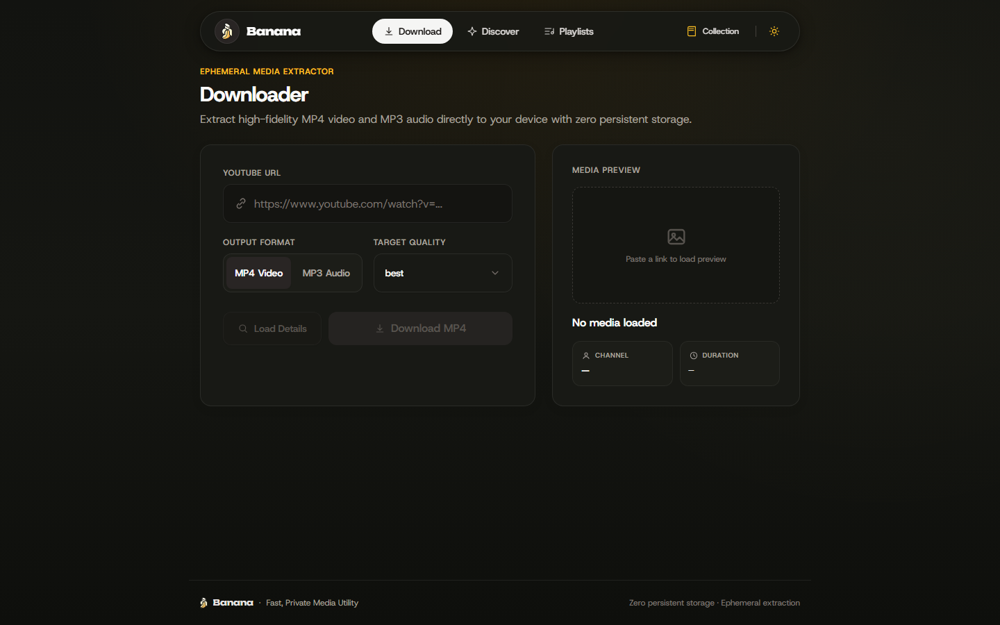
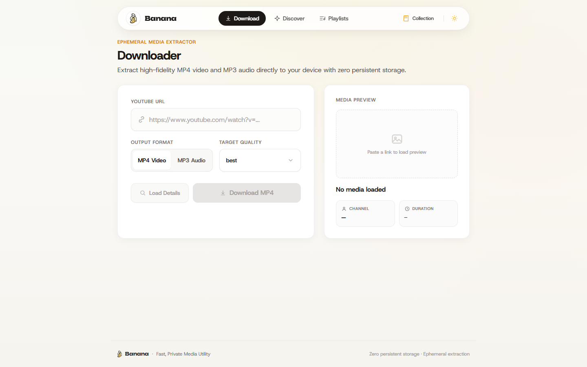
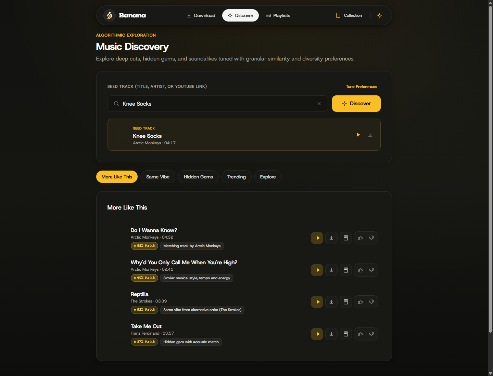
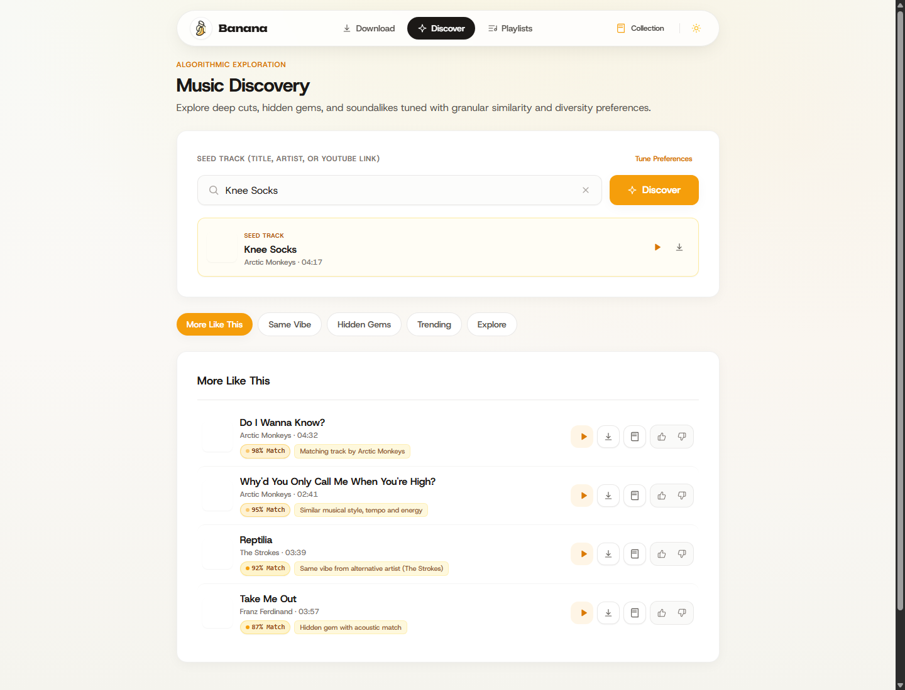
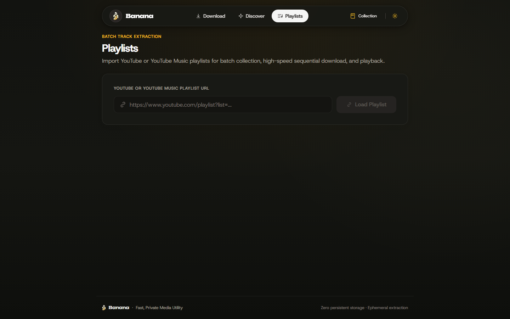
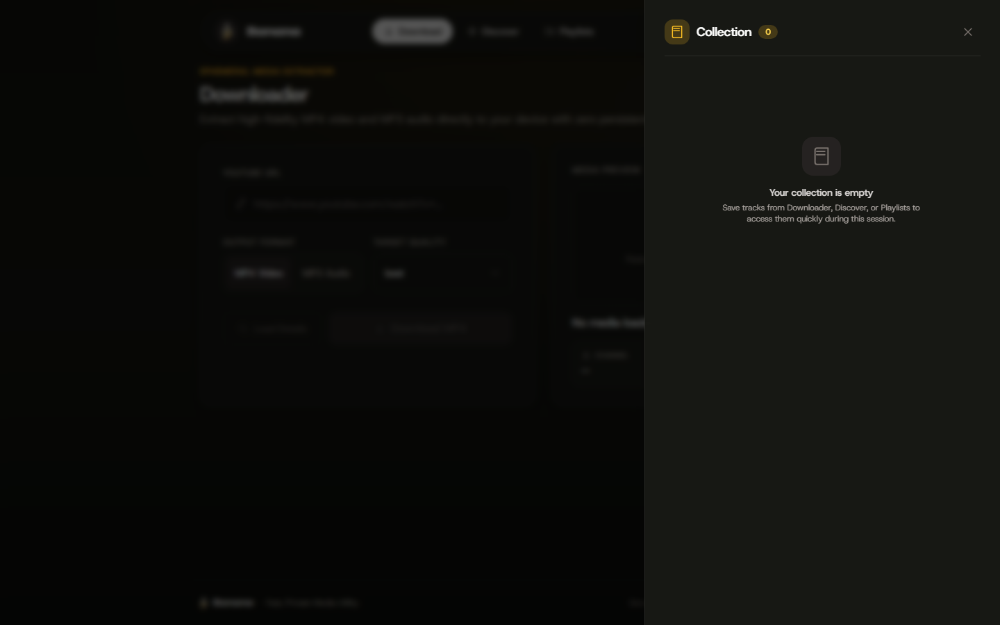
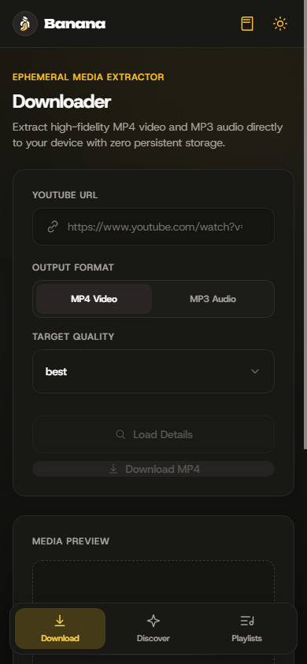
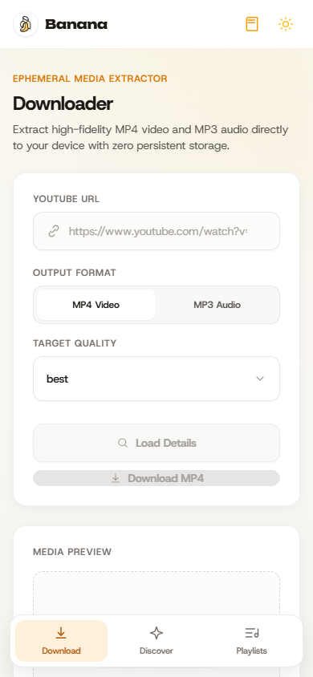

<div align="center">
  

  # Banana

  **Fast, Private Media Utility & Music Discovery Engine**

  *An Apple-grade personal media companion featuring zero-storage streaming, precision segment trimming, batch playlist downloads, and algorithmic music similarity exploration.*

  <br />

  [](https://www.typescriptlang.org/)
  [](https://react.dev/)
  [](https://tailwindcss.com/)
  [](https://fastapi.tiangolo.com/)
  [](https://python.org/)
  [](https://github.com/yt-dlp/yt-dlp)
  [](https://ffmpeg.org/)
  [](#-privacy--ephemeral-lifecycle)
  [](LICENSE)

  <br />

  <p align="center">
    <a href="#-overview">Overview</a> •
    <a href="#-showcase">Showcase</a> •
    <a href="#-key-features">Key Features</a> •
    <a href="#-design-system">Design System</a> •
    <a href="#-quick-start">Quick Start</a> •
    <a href="#-api-reference">API Reference</a> •
    <a href="#-privacy--ephemeral-lifecycle">Privacy & Storage</a>
  </p>
</div>

---

## 🌟 Overview

**Banana** is a modern, privacy-first media utility and music exploration application. Built with an obsessive focus on quiet, distraction-free design, Banana delivers studio-grade media downloads, instant in-stream previews, lossless segment trimming, and an intelligent music discovery engine—all without requiring accounts, sign-ups, cookies, or persistent server storage.

### Why Banana?

* ⚡ **Lightning-Fast Media Ingestion** — Extract video (MP4) and audio (MP3) at native resolutions from YouTube, YouTube Shorts, and YouTube Music.
* 🎧 **Zero-Download Stream Previews** — Listen to high-fidelity audio or watch video previews immediately via direct HTTP chunk piping without touching server disk space.
* 🧠 **Algorithmic Music Discovery** — Discover deep cuts, soundalikes, and hidden gems with real-time **Similarity Match Percentages** (e.g. `98% Match`) and semantic explanation badges.
* ✂️ **Precision Lossless Trimmer** — Snip audio clips and ringtones down to the exact millisecond using FFmpeg copy-streams.
* 📦 **Batch Playlist Collector** — Parse entire playlists, select candidate tracks, and queue automated batch downloads.
* 🛡️ **Zero Persistent Footprint** — Ephemeral jobs expire in 300 seconds and are purged automatically by background scavenger workers.

---

## 📸 Showcase

### Quiet Utility Canvas (Dark & Light)

| Dark Theme | Light Theme |
| :---: | :---: |
|  |  |

---

## ✨ Key Features

### 1. Algorithmic Music Discovery with Similarity % Match
Discover songs that share the exact acoustic DNA, production vibe, or tempo of your favorite tracks. Simply enter any song title (e.g. *"Knee Socks" by Arctic Monkeys*) or paste a YouTube link to establish a **Seed Track**.

| Music Discovery (Dark) | Music Discovery (Light) |
| :---: | :---: |
|  |  |

* **Similarity Percentage Badges**: Real-time calculated affinity scores (e.g. `98% Match`, `95% Match`, `92% Match`) featuring glowing status indicators for top acoustic matches.
* **Semantic Affinity Reasons**: Informative badges detail why each track was chosen (e.g. *"Same vibe from alternative artist (The Strokes)"*, *"Hidden gem with acoustic match"*).
* **5 Exploration Lenses**:
  * 🎯 **More Like This** — Closest overall musical match in style, rhythm, and genre.
  * 🎸 **Same Vibe** — Kindred alternative artists excluding the seed artist.
  * 💎 **Hidden Gems** — Deeper album cuts and underrated tracks rather than chart staples.
  * 🔥 **Trending** — Globally viral tracks currently resonating across music charts.
  * 🌐 **Explore** — Cross-genre productions sharing similar energy and tempo.
* **Interactive Taste Steering**: Thumbs Up immediately boosts that artist across subsequent queries; Thumbs Down retains the song visibly while steering future recommendations away from that style.

---

### 2. Batch Playlist Processor
Parse playlists from YouTube and YouTube Music with instantaneous track listing extraction, bulk selection controls, and real-time download telemetry.

<div align="center">
  
</div>

* **One-Click Select All**: Easily toggle entire playlists or cherry-pick specific tracks.
* **Simultaneous Collection**: Add multiple tracks straight to your session drawer with a single click.
* **Live Progress Telemetry**: Visual track-by-track download progress bar with error tolerance.

---

### 3. Precision Segment Trimming
Extract ringtones, sample loops, voice memos, or video clips with millisecond accuracy.

* **Dual-Handle Timeline Scrubber**: Adjust start and end boundaries smoothly.
* **Timestamp Precision**: Input manual `mm:ss` timestamps with live format validation.
* **Direct FFmpeg Stream Copy**: Extremely fast extraction without re-encoding loss.

---

### 4. Ephemeral Collection Drawer & Adaptive Mobile Dock
Browse, stage, and audition songs in a slide-over drawer that adapts to desktop floating capsules and mobile dock layouts.

| Collection Drawer | Mobile Viewport (Dark & Light) |
| :---: | :---: |
|  |   |

* **Floating Capsule Navigation**: Desktop floating pill with blurred glassmorphism (`backdrop-blur-md`).
* **Mobile Bottom Dock**: Perfectly spaced 3-column dock mathematically guaranteed to fit compact mobile viewports down to 320px.
* **Two-Tier Accessible Focus**: High-contrast two-tier focus rings (`0 0 0 2px #fff, 0 0 0 4px #D97706`) for complete keyboard accessibility.

---

## 🎨 Design System

Banana inherits its design discipline from the **Kiwi Design System**, transformed into a warm, modern brand identity derived from the official vector icon (`banana-icon.svg`):

* **Palette**:
  * 🟡 **Primary Accent**: Banana Peel (`#FCDD82`) & Golden Amber (`#F9B04A` / `#D97706`)
  * 🥛 **Soft Backgrounds**: Warm Cream (`#FFF8D1` / `#FFFBEB`)
  * 🪨 **Canvas Surfaces**: Quiet Utility Light (`#F8F9F5`) and Deep Carbon Dark (`#121310`)
* **Typography**:
  * **Headings & Display**: `Unbounded` — Distinct, contemporary, and bold.
  * **Body & Interface**: `Host Grotesk` — Clean, legible, and balanced.
  * **Metrics & Scores**: `JetBrains Mono` / `ui-monospace` — Precise and tabular.
* **Surfaces**: Solid elevated card layers with subtle borders (`border-black/[0.06]` / `border-white/[0.08]`) and restrained soft shadows (`shadow-soft`, `shadow-lift`).

---

## 🛡️ Privacy & Ephemeral Lifecycle

Banana is engineered from the ground up to respect user privacy:

```
[ User Action: Preview Track ]
       │
       ▼
[ yt-dlp: Resolve Direct Stream URL ]
       │
       ▼
[ Direct HTTP Chunk Pipe (64 KB) ] ──▶ [ Browser HTML5 Audio/Video ]
       │
       └──▶ 0 bytes written to server disk. Zero persistent logging.

─────────────────────────────────────────────────────────────────────────

[ User Action: Download / Trim ]
       │
       ▼
[ Atomic Job Sandbox: %TEMP%/banana_media_temp/job_<uuid>/ ]
       │
       ├── Token generated (300-second TTL)
       ├── Direct download delivered to user
       └── Async Scavenger Task (runs every 60s) instantly purges expired files
```

* **No User Accounts** — No sign-up, login, OAuth, or personal data stored.
* **No Database Required** — Completely stateless execution.
* **Ephemeral Staging** — Files are written only temporarily during active downloads and immediately deleted upon transfer completion or after 300 seconds.

---

## 🚀 Quick Start

### Prerequisites
* **Node.js** 18.x or later (`node -v`)
* **Python** 3.10 or later (`python --version`)
* **FFmpeg** installed and accessible in your system `PATH` (`ffmpeg -version`)

---

### 1. Clone the Repository
```bash
git clone https://github.com/your-username/banana.git
cd banana
```

---

### 2. Backend Setup (FastAPI)
```bash
cd server

# Create and activate Python virtual environment
python -m venv venv

# Windows (PowerShell)
.\venv\Scripts\Activate.ps1
# macOS / Linux
source venv/bin/activate

# Install dependencies
pip install -r requirements.txt

# Launch backend server (runs on http://127.0.0.1:8000)
python run.py
```

---

### 3. Frontend Setup (React + Vite)
```bash
# In a new terminal window
cd client

# Install NPM dependencies
npm install

# Start development server
npm run dev
```

Open your browser at **`http://localhost:5173`** (or the host specified in your terminal).

---

### 4. Production Build
```bash
# Compile and optimize frontend
cd client
npm run build

# Preview production build locally
npm run preview
```

---

## 🧪 Testing

Banana maintains comprehensive automated test coverage across media validation, ephemeral cleanup, playlist parsing, and recommendation similarity scoring:

```bash
# Run backend test suite
cd server
.\venv\Scripts\python.exe -m unittest test_backend.py test_resilience.py

# Type-check and build frontend
cd client
npm run build
```

---

## 🔌 API Reference

The backend provides clean, documented REST endpoints:

| Endpoint | Method | Description |
| :--- | :---: | :--- |
| `/api/media/info?url=<url>` | `GET` | Extract media title, thumbnail, duration, and metadata. |
| `/api/media/stream?url=<url>` | `GET` | Stream direct audio/video chunks with HTTP range support. |
| `/api/media/prepare` | `POST` | Stage an MP4 or MP3 download and receive an ephemeral token. |
| `/api/media/download/<token>` | `GET` | Retrieve prepared media file (deleted immediately after download). |
| `/api/trim` | `POST` | Lossless segment extraction between `start_time` and `end_time`. |
| `/api/playlist/info?url=<url>` | `GET` | Extract track list and count for YouTube/YouTube Music playlists. |
| `/api/discover/seed` | `POST` | Resolve song query or URL to a pinned seed track. |
| `/api/discover/recommendations` | `POST` | Generate recommendations with match scores and reason tags. |

---

## ⌨️ Keyboard Shortcuts

| Shortcut | Action |
| :---: | :--- |
| <kbd>Space</kbd> / <kbd>K</kbd> | Play / Pause media playback |
| <kbd>←</kbd> / <kbd>→</kbd> | Seek backward / forward 5 seconds |
| <kbd>M</kbd> | Toggle audio mute |
| <kbd>Tab</kbd> | Navigate interactive controls with high-contrast 2-tier focus rings |
| <kbd>Esc</kbd> | Close Collection Drawer or popup listboxes |

---

## 📁 Project Structure

```text
banana/
├── assets/                          # Official brand assets & screenshots
│   ├── banana-icon.svg              # Vector brand mark & app logo
│   └── screenshots/                 # Application screenshots (desktop & mobile)
│
├── client/                          # React + TypeScript + Tailwind frontend
│   ├── public/                      # Static assets & local font files
│   │   ├── banana-icon.svg          # Favicon & brand mark
│   │   └── fonts/                   # Local Host Grotesk & Unbounded webfonts
│   ├── src/
│   │   ├── components/              # UI components
│   │   │   ├── CollectionDrawer.tsx # Slide-over saved tracks drawer
│   │   │   ├── DiscoverView.tsx     # Music discovery with similarity % badges
│   │   │   ├── MediaPlayer.tsx      # Stream player with timeline scrubber
│   │   │   ├── PlaylistView.tsx     # Batch playlist downloader
│   │   │   ├── Select.tsx           # Accessible custom dropdown
│   │   │   ├── TrimPanel.tsx        # Segment extraction editor
│   │   │   └── icons.tsx            # SVG vector icons & BananaMark logo
│   │   ├── lib/                     # API client, types & utilities
│   │   ├── App.tsx                  # Main layout & navigation shell
│   │   └── index.css                # Custom theme variables & design tokens
│   ├── tailwind.config.ts           # Banana brand palette & design tokens
│   └── package.json                 # Client dependencies & scripts
│
├── server/                          # FastAPI + Python backend
│   ├── discover_service.py          # Music discovery & similarity scoring engine
│   ├── media_service.py             # yt-dlp metadata & streaming engine
│   ├── playlist_service.py          # Playlist parsing & batch extraction
│   ├── trim_service.py              # FFmpeg millisecond segment trimmer
│   ├── storage.py                   # Ephemeral storage manager & scavenger
│   ├── main.py                      # FastAPI application & REST endpoints
│   ├── run.py                       # Resilient launcher with port recovery
│   ├── test_backend.py              # Unit tests for discovery, trimming, storage
│   └── requirements.txt             # Python backend dependencies
│
└── README.md                        # Documentation
```

---

## 📄 License

This project is licensed under the [MIT License](LICENSE).

---

<div align="center">
  <sub>Crafted with passion for quiet, thoughtful, and high-performance software.</sub>
</div>

